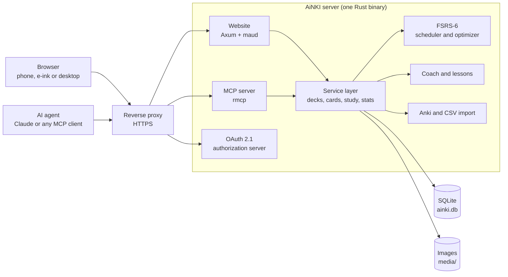

# AiNKI

You want to remember things for years: vocabulary, the material for an exam, the facts your work depends on. Spaced repetition is the method for that. You write cards, and a scheduler shows each one again just before you would forget it. Today, an AI assistant can also write those cards with you and quiz you on them, if the flashcard service lets it in.

AiNKI is a self-hosted flashcard service for that situation. A card is a front and a back in Markdown, FSRS-6 decides when you see it again, and everything you can do on the website an AI agent such as Claude can do too, within the permissions you give it. It runs on a phone, an e-ink reader or a desktop, and it is small enough to host for yourself and a few friends on one server.

Ready to try it? Jump to the [installation instructions](#installation).

## Features

### Cards and decks

- Cards are a front and a back. Each side is Markdown plus one optional image, with no note types, templates or cloze syntax to learn.
- Multicards turn a back with several things to recall into separate items: the items of its lists, its sections under headings, or its parts between `---` lines. After the reveal you tap what you remembered, every item gets its own schedule, and the next round asks only for what you missed.
- Decks can be paused, which rests all their cards until you resume, or archived, which also takes them off Home, Stats and the coach. Cards you suspended by hand stay suspended when a deck comes back.
- Two or more decks merge into a new one. You choose whether the cards keep their review progress and whether the old decks go.
- Decks can be shared by handle (`name#1234`). The other person gets their own copy with fresh progress.
- Anki `.apkg` and `.colpkg` files import with their review history, so FSRS starts from your real memory. CSV import and export work too.

### Scheduling and studying

- FSRS-6 schedules every card, starting from parameters fitted on about 10,000 Anki collections. Once you have a few hundred reviews, AiNKI refits them to your own history about once a month and keeps the new ones only if they predict your past reviews better.
- Five presets cover common situations, from Exam prep at 95% retention to Maintenance at 80%. Each preset's page simulates the next 30, 90 or 365 days at several retentions with your own memory and speed.
- Two answer buttons by default, Again and Good. Hard and Easy can be turned on.
- Optional timed cards, typed answers, a "sure or not?" check, quiet hours, suggested breaks and a catch-up mode after time away. During quiet hours agents don't quiz you either.
- With JavaScript, studying never reloads the page. Without it, every page still works.

### Learning to learn

- A rule-based coach flags cards that keep slipping, ask too much at once or look like another card, and offers to split them. On Home and Stats it gives one piece of advice at a time. AiNKI calls no AI model itself; you decide.
- 18 short lessons explain FSRS, what memory research says, with how strong the evidence is, and how to write good cards. Each can be added as a deck.
- Stats show the week, retention per deck against its aim, how well FSRS predicts your memory and how often you were right when you felt sure. On a desktop they are charts with a hover for every value, and an "I love numbers" switch shows the exact tables.

### Two looks

- The simple look serves phones, e-ink readers and browsers without JavaScript: grayscale, high contrast, no animations, large tap targets. Images are dithered to 16 gray levels on upload.
- On a desktop, AiNKI switches to a watercolor look: hard white pages, EB Garamond titles, soft washes of Wild Orchid and Terra Cotta, and a dark mode. A single dot in the corner opens into the places of the app, and a fuzzy quick find (any letter, `/` or Ctrl+K) reaches every deck, card and lesson. Home shows the cards due over the next 7 days, and `?` lists the keyboard shortcuts.
- Anyone can choose the simple look in settings.

### Agents

- A full MCP server with 40 tools: decks, cards, images, studying, presets, imports, sharing, the coach, stats and lessons.
- Connecting Claude takes the server's URL and one click, through the standard OAuth 2.1 flow. Clients without OAuth use a hand-made token.
- Access is scoped: read-only, studying, or editing, and all decks or only some. Agents can never change your password or settings, and their reviews are labelled so you can leave them out of FSRS optimization.

### Accounts and invitations

- Accounts are a username and password. Usernames get a tag (`kolja#4821`), so two people can pick the same name.
- AiNKI grows by invitation. Every account can send one single-use link a week, starting a week after it joined.
- A separate admin account sees who invited whom and an overview of all accounts. It has no decks of its own.

### Security and tests

- Passwords are hashed with Argon2id, logins are throttled per IP and per account, and session tokens are stored hashed in `HttpOnly`, `SameSite=Lax` cookies (`Secure` and `__Host-` over HTTPS).
- A strict Content Security Policy with no inline scripts, `frame-ancestors 'none'` and an Origin check on every form post. Card Markdown is rendered with raw HTML disabled and sanitized again.
- OAuth uses PKCE (S256 only), exact redirect URIs, 1-hour access tokens and rotating refresh tokens; reusing an old refresh token revokes the connection. The one outgoing request, fetching OAuth client metadata, goes only to public HTTPS addresses, pinned against DNS rebinding.
- Uploads are size-limited before decoding and re-encoded. Anki packages are read with limits against zip and zstd bombs, and opened read-only with SQLite's `trusted_schema` off.
- The container runs as an unprivileged user with a read-only root filesystem, all capabilities dropped and `no-new-privileges`. `cargo audit` is clean apart from one advisory for code that is never compiled (see `.cargo/audit.toml`).
- About 160 Rust tests and 88 Playwright tests, run in Chromium and Firefox on desktop, simple look and phone. A separate job seeds data with the last v1 release and checks that it survives the upgrade.

## Tech stack



The website and the MCP server are thin layers over the same service, so agents and people get the same capabilities and the same rules. All state lives in one SQLite file and a folder of images, which makes a backup a single copy of a Docker volume.

AiNKI is written in Rust, with plain CSS and a little JavaScript for the desktop look. The main libraries:

- [Axum](https://github.com/tokio-rs/axum) for HTTP and [maud](https://maud.lambda.xyz/) for server-rendered HTML
- [rmcp](https://github.com/modelcontextprotocol/rust-sdk) for the MCP server (Streamable HTTP, stateless)
- [fsrs-rs](https://github.com/open-spaced-repetition/fsrs-rs) for scheduling and optimization
- [SQLx](https://github.com/launchbadge/sqlx) with SQLite, migrations in `migrations/`
- [pulldown-cmark](https://github.com/pulldown-cmark/pulldown-cmark) and [ammonia](https://github.com/rust-ammonia/ammonia) for safe Markdown
- [image](https://github.com/image-rs/image) for resizing and dithering, [zip](https://github.com/zip-rs/zip2) and [zstd](https://github.com/gyscos/zstd-rs) for Anki packages
- [Playwright](https://playwright.dev/) for the browser tests

[docs/code.md](docs/code.md) maps the source files, and [docs/scheduling.md](docs/scheduling.md) explains the presets and study options in detail.

To run the server and the tests locally:

```sh
AINKI_DATA_DIR=./data cargo run
cargo test

cargo build
cd e2e
npm ci
npx playwright install chromium firefox
npm test                  # or npm run test:chromium
```

The Playwright tests use the debug binary from `cargo build` and start it on a temporary data directory by themselves. CI (`.github/workflows/test.yml`) runs all three suites on every pull request.

## Roadmap

- Export to `.apkg`.

## Installation

```sh
git clone https://github.com/vdTwer/AiNKI.git
cd AiNKI
docker compose up -d
```

Open <http://localhost:8080> and create your account. The first account can always sign up; after that, new people join through invite links (Settings → Invite someone), unless you set `AINKI_ALLOW_SIGNUP=true`. Data lives in the `ainki-data` Docker volume.

AiNKI listens on `127.0.0.1:8080` only, so it is reachable from this machine but not directly from the network. Put a reverse proxy with HTTPS in front of it.

### Behind Caddy

`.env` next to `docker-compose.yml`:

```sh
AINKI_PUBLIC_URL=https://cards.example.com
```

`Caddyfile`:

```
cards.example.com {
    reverse_proxy 127.0.0.1:8080
}
```

Caddy gets the certificate. With an `https://` public URL, AiNKI marks its cookies Secure (`__Host-` prefixed) and sends HSTS. If Caddy runs in Docker on the same network, use `reverse_proxy ainki:8080` instead.

### Settings

All optional, in `.env`:

| Variable | Default | Meaning |
| --- | --- | --- |
| `AINKI_PUBLIC_URL` | (from request) | Your public address, e.g. `https://cards.example.com`. Needed for connecting Claude (OAuth issuer and MCP URL); also turns on Secure cookies and HSTS. |
| `AINKI_ALLOW_SIGNUP` | `false` | Let anyone create an account without an invite. The first account can always sign up. |
| `AINKI_TIMEZONE` | `UTC` | Default timezone for new accounts. Each user can change theirs. |
| `AINKI_PORT` | `8080` | Port on the host. |
| `AINKI_LISTEN` | `127.0.0.1` | Host address to listen on. `0.0.0.0` exposes AiNKI without a proxy (plain HTTP, not recommended). |
| `AINKI_SECURE_COOKIES` | `false` | Force Secure cookies even without an `https://` public URL. |

### Invites and the admin account

Every account can make one invite link a week, starting a week after it joined. A link works once, for 30 days, and can be taken back while unused.

The admin account is separate from your own. It has no decks; logging in shows only the admin panel: who invited whom, and an overview of all accounts. It can make invite links without a limit. Create it once:

```sh
docker compose exec ainki ainki create-admin admin 'a-long-password'
```

### Admin commands

There's no email, so password resets are done on the server:

```sh
docker compose exec ainki ainki create-user anna 'initial-password'
docker compose exec ainki ainki list-users
docker compose exec ainki ainki reset-password 'kolja#4821' 'new-password'
```

### Backups

Everything is in the volume: `ainki.db` (SQLite) and `media/`. To make a consistent copy:

```sh
docker compose stop && docker run --rm -v ainki_ainki-data:/data -v "$PWD":/backup debian:trixie-slim tar czf /backup/ainki-backup.tgz -C /data . && docker compose start
```

### Connect Claude (or any MCP client)

AiNKI must be reachable on a public HTTPS address (set `AINKI_PUBLIC_URL`). Then:

1. In Claude, open **Settings → Connectors → Add custom connector**.
2. Paste `https://<your host>/mcp`.
3. Click **Connect**, log in to AiNKI, click **Allow**.

On the approval page you choose what Claude may do: add, edit and delete cards and decks; quiz you and record your answers; all decks or only some. Connected apps are listed under **Settings → Agent access**, where you can disconnect them.

This is the standard MCP authorization flow (OAuth 2.1 with PKCE, dynamic client registration and client metadata documents), so other MCP clients that support OAuth connect the same way. Claude Code on the same machine can also use a plain `http://localhost` address:

```sh
claude mcp add --transport http ainki http://localhost:8080/mcp
```

For agents without OAuth support, create a token by hand under **Settings → Agent access** and send it as `Authorization: Bearer <token>`.

Agents can never change your password or settings, or create tokens. Reviews done through an agent are labelled, and you can leave them out of FSRS optimization.

During quiet hours `get_next_card` returns no card, so agents don't quiz you then.

## License

MIT. FSRS scheduling comes from [fsrs-rs](https://github.com/open-spaced-repetition/fsrs-rs) (BSD-3-Clause), and EB Garamond is under the SIL Open Font License. AiNKI contains no code from Anki itself (AGPL); it is compatible with Anki's file format only.
